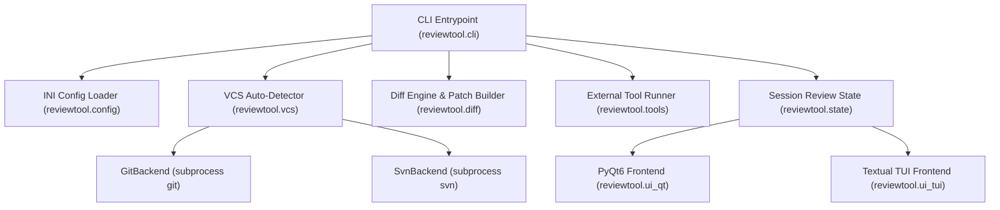

# `reviewtool` — Design & Implementation Plan

## 1. Overview & Architecture

`reviewtool` is a local pre-commit code review application supporting **Git** and **Subversion (SVN)** repositories with two frontends sharing a single headless core:
- **PyQt6 GUI** (`--gui`, default when `DISPLAY` or `WAYLAND_DISPLAY` is set)
- **Textual TUI** (`--tui`, or automatic fallback when running in a headless terminal)



---

## 2. Project Layout

All code adheres to project rules:
- Virtual environment at `env/` (`env/bin/pytest` for testing)
- 88-column maximum line length
- All imports at top of file
- No blanket catch-all exception handlers
- No `getattr` attribute guessing

```text
/work/pyte/reviewtool/
├── PLAN.md
├── pyproject.toml
├── src/
│   └── reviewtool/
│       ├── __init__.py
│       ├── cli.py           # CLI args (--gui, --tui, --config, repo path)
│       ├── config.py        # Global INI config loader/writer & default tools
│       ├── models.py        # Dataclasses: FileEntry, DiffLine, DiffHunk, FileDiff, ToolSpec
│       ├── diff.py          # Unified diff parser, word-diff calculator, partial patch builder, expander
│       ├── vcs/
│       │   ├── __init__.py  # detect_vcs(path) -> VCSBackend
│       │   ├── base.py      # Abstract VCSBackend protocol/ABC
│       │   ├── git.py       # GitBackend (status, diff, stage/unstage/revert file/hunk/lines, commit, amend)
│       │   └── svn.py       # SvnBackend (status, diff, virtual stage list, svn add/rm/revert, commit)
│       ├── tools.py         # Placeholder interpolation & process runner (background, terminal, output)
│       ├── state.py         # Session controller (in-memory viewed set, context lines, expanded ranges)
│       ├── ui_qt/
│       │   ├── __init__.py
│       │   ├── app.py       # MainWindow: left split (Unstaged, Staged, Viewed, Commit), right diff pane
│       │   ├── diff_view.py # Custom diff widget supporting all 3 rendering modes, gutter, word-Under-cursor
│       │   └── dialogs.py   # Tool output viewer dialog, confirmation modals
│       └── ui_tui/
│           ├── __init__.py
│           ├── app.py       # Textual App: Unstaged/Staged tables, Diff pane, Commit box, keybindings
│           └── diff_pane.py # Textual interactive diff line list with cursor word tracking & hunk expansion
└── tests/
    ├── test_config.py
    ├── test_diff.py
    ├── test_vcs_git.py
    ├── test_vcs_svn.py
    ├── test_tools.py
    └── test_state.py
```

---

## 3. Core Subsystems

### 3.1 Split Global INI Configuration (`config.ini` & `tools.ini`)

Configuration in `~/.config/reviewtool/` is split into two separate INI files (both using `configparser.ConfigParser(interpolation=None)`):

1. **`~/.config/reviewtool/config.ini`** — Generic options & PyQt window/layout geometry.
   - **Saved ASAP on change**: Whenever any option changeable in the UI is toggled or adjusted (`context_lines`, `render_mode`, `hide_viewed`, `full_file`, or PyQt window geometry / splitter sizes on resize/move), `config.ini` is written immediately (not deferred until exit).
   - **PyQt UI Position & Geometry Persistence**: Saves and restores exact window position & size (`window_x`, `window_y`, `window_width`, `window_height`, `window_maximized`) plus main horizontal and left-pane vertical splitter sizes (`main_splitter`, `left_splitter`) so the PyQt window always reopens right where it was last used.

```ini
[general]
default_ui = auto
context_lines = 3
# render_mode: full (dual gutter + word diff + pygments), word_diff (dual gutter + word diff), simple (single gutter + basic +/- colors)
render_mode = full
full_file = false
hide_viewed = false
tab_width = 4
theme = dark

[ui_qt]
window_x = 120
window_y = 80
window_width = 1400
window_height = 900
window_maximized = false
main_splitter = 380,1020
left_splitter = 320,320,260
```

2. **`~/.config/reviewtool/tools.ini`** — External tool definitions only (auto-created with default tools if missing; never overwritten by UI option saves).

```ini
[tool:editor]
name = Open in Editor
command = ${EDITOR:-vim} +{line} {abs_file}
mode = terminal
shortcut = e
refresh_after = true

[tool:vscode]
name = VS Code at Line
command = code --goto {abs_file}:{line}:{col}
mode = background
shortcut = v
refresh_after = false

[tool:grep_word]
name = Grep Word in Repo
command = git grep -n {word}
mode = output
shortcut = g
refresh_after = false

[tool:blame]
name = Blame Line
command = {vcs} blame -L {line},{line} {file}
mode = output
shortcut = b
refresh_after = false
```

#### Supported Placeholders for External Tools
Every tool `command` is parsed with `shlex.split` and each token substitutes any combination of:
- `{file}`: Path relative to repository root
- `{abs_file}`: Absolute filesystem path
- `{dir}` / `{abs_dir}`: Relative / absolute directory containing the file
- `{filename}` / `{stem}` / `{ext}`: Basename, filename without extension, and file extension
- `{line}`: Best-effort target line number (new line if on context/added line; old line if on deleted line; `1` if header)
- `{old_line}`: Original file line number (or empty/fallback to `{line}`)
- `{new_line}`: Working tree file line number (or empty/fallback to `{line}`)
- `{col}`: 1-based column under cursor
- `{word}`: Identifier/word under cursor (alphanumeric + `_`)
- `{selection}`: Currently selected text in the diff view (falls back to `{word}` if empty)
- `{line_text}`: Full text of the current diff line (without leading `+`/`-`/` `)
- `{repo_root}`: Absolute path to the repository root
- `{vcs}`: `"git"` or `"svn"`
- `{branch}`: Current branch name or SVN URL/revision
- `{status}`: Status code of the current file (`M`, `A`, `D`, `?`, `!`, `R`)
- `{staged}`: `"1"` if viewing a staged diff, `"0"` if viewing an unstaged diff

#### Tool Execution Modes
- `background`: Spawns detached process via `subprocess.Popen`. If `refresh_after = true`, schedules a repo status/diff refresh when the process exits.
- `terminal`:
  - In **TUI**, uses `app.suspend()` to yield the terminal directly to `subprocess.run`, then resumes and refreshes if `refresh_after = true`.
  - In **GUI**, launches via configured terminal emulator (`x-terminal-emulator -e`, `kitty`, `alacritty`, `gnome-terminal`, or `xterm`) and refreshes on exit.
- `output`: Runs command, captures `stdout` + `stderr` + exit code, and displays them in a scrollable modal dialog / panel.

---

### 3.2 VCS Backends (`GitBackend` & `SvnBackend`)

| Capability | `GitBackend` | `SvnBackend` |
| :--- | :--- | :--- |
| **Root Detection** | `git rev-parse --show-toplevel` | `svn info --show-item wc-root` |
| **Status Scan** | `git status --porcelain=v1 -z -uall` | `svn status --xml` (or fixed-column output) |
| **Unstaged Diff** | `git diff --no-color -U<N> -- <file>` (or synthetic `+` diff for untracked `?` files) | `svn diff -x -U<N> <file>` (when file is not in virtual staged set; synthetic `+` diff for `?`) |
| **Staged Diff** | `git diff --cached --no-color -U<N> -- <file>` | Same working-copy diff shown when file is in the virtual Staged set |
| **Stage File** | `git add -- <file>` | Adds `<file>` to in-memory Staged set (and runs `svn add` if `?`, `svn rm` if `!`) |
| **Unstage File** | `git reset HEAD -- <file>` (or `git rm --cached` on unborn HEAD) | Removes `<file>` from in-memory Staged set |
| **Revert File** | `git checkout -- <file>` (or prompts & removes untracked `?` file) | `svn revert <file>` (or prompts & removes untracked `?` file) |
| **Stage / Unstage / Revert Hunk or Lines** | Builds valid unified patch from selected hunk/lines and pipes to `git apply --cached [--reverse] --recount` or `git apply -R --recount` | Applies inverse hunk/line patch to working file on disk (for revert); file-level selection for stage |
| **Commit** | `git commit -m <msg> [--amend]` | `svn commit -m <msg> -- <staged_files...>` |
| **Amend Prefill** | `git log -1 --format=%B` | N/A (Amend checkbox hidden/disabled in SVN mode) |
| **Sign Off** | Appends `Signed-off-by: Name <email>` using `git config` or `$USER` | Appends `Signed-off-by: <username>` |

---

### 3.3 Diff Engine, Context Expansion & Rendering Modes

1. **Configurable Context (`-U<N>`) & Per-Gap Expansion**:
   - Toolbar stepper (`-` / `+` buttons and `[` / `]` hotkeys) adjusts base context lines $N \in [0, 999]$ (default `3`), plus a **Full File** toggle button.
   - Between non-contiguous hunks, the diff model inserts an `ExpandDivider(start_new_line, end_new_line, hidden_count)`.
   - Clicking or pressing `Enter` on a divider reads the hidden slice from the working tree / base version and merges it into the displayed hunks without losing scroll position.

2. **Three Configurable Rendering Modes** (switchable in INI and live via dropdown/hotkey `m`):
   - `full`: Dual line-number gutter (`old_ln | new_ln`), green/red line background tint, intra-line word-diff highlight spans (`difflib.SequenceMatcher` on paired `-`/`+` blocks), and Pygments syntax highlighting tokens.
   - `word_diff`: Dual line-number gutter, green/red line background tint, and intra-line word-diff highlight spans (no syntax highlighting colors).
   - `simple`: Single line-number gutter and classic unified diff `+`/`-`/` ` foreground/background coloring.

3. **Hunk & Line Patch Construction (`reviewtool.diff.build_partial_patch`)**:
   - Given a `FileDiff`, a `DiffHunk`, and an optional set of selected line indices within the hunk:
   - For **Stage Lines**: unselected `-` lines become context (` `) lines, unselected `+` lines are omitted, and hunk header counts (`@@ -old,count +new,count @@`) are recalculated automatically.
   - For **Unstage / Revert Lines**: unselected `+` lines become context (` `) lines, unselected `-` lines are omitted.

---

### 3.4 Performance & Large-Repo Scalability (No Full Rescan on Click)

Repositories may be very large and have hundreds or thousands of changed files. To keep the UI instantaneous:

1. **Full Status Scan Only When Requested**:
   - A full repository status scan (`git status` / `svn status`) runs **only** on initial startup, when the user explicitly clicks **Rescan / Refresh** (`F5` / `r`), after a **Commit**, or after an external tool with `refresh_after = true` exits.
   - Clicking a file in the Unstaged/Staged lists or toggling a **Viewed** checkbox **never** triggers a repository status rescan.

2. **Targeted Single-File Updates on Stage / Unstage / Revert**:
   - When staging, unstaging, or reverting a single file (or hunk/lines within a file), **do not** rescan the entire repository.
   - Instead, query status/diff **only for that specific file path** (`git status --porcelain=v1 -z -- <file>` / `svn status -- <file>`) and update the in-memory `unstaged_files` and `staged_files` lists plus the diff cache for that single path in $O(1)$ VCS calls.

3. **In-Memory Diff Caching & Lazy Loading**:
   - Diffs are fetched lazily per file only when the user selects that file, not preloaded for all changed files at startup.
   - Parsed `FileDiff` objects are cached in memory keyed by `(file_path, is_staged, context_lines)`.
   - Clicking between already-inspected files renders from the in-memory cache immediately with zero VCS subprocess calls.
   - Only the affected file's cache entry is invalidated when that file (or one of its hunks/lines) is staged, unstaged, or reverted; pressing **Rescan** clears the diff cache.

---

### 3.5 UI Layout & Interaction

```text
+-----------------------------------+---------------------------------------------------+
| [Rescan] [Context: - 3 +] [Full]  | File: src/foo.py (Unstaged)   [Mode: Full v]      |
| [Hide Viewed]    [Tools v]        | [Stage Hunk] [Revert Hunk] [Stage Lines]          |
+-----------------------------------+---------------------------------------------------+
| Unstaged Changes (4)   [Stage All]|   12 |   12 |   def calculate(x, y):              |
| [ ] M src/foo.py                  |   13 |      | -     return x + y                  |
| [x] M src/bar.py         (Viewed) |      |   13 | +     return (x + y) * 2            |
| [ ] ? src/new_helper.py           |   14 |   14 |                                     |
+-----------------------------------+------ [ ↕ Expand 24 hidden lines ] ---------------+
| Staged Changes (1)   [Unstage All]|   39 |   39 |   def main():                       |
| [x] M README.md          (Viewed) |      |   40 | +     print("ready")                |
+-----------------------------------+---------------------------------------------------+
| Commit Message:                   | Right-Click / Hotkey Context on Line 13, Word:    |
| +-------------------------------+ |  - Stage Hunk / Stage Selected Lines              |
| | Fix calculation factor        | |  - Revert Hunk / Revert Selected Lines            |
| +-------------------------------+ |  -----------------------------------------------  |
| [ ] Amend   [Sign Off]   [Commit] |  - [e] Open in Editor (foo.py:13)                 |
+-----------------------------------+  - [g] Grep Word in Repo ("calculate")            |
                                    |  - [b] Blame Line (foo.py:13)                     |
                                    +---------------------------------------------------+
```

- **Left Pane**:
  - **Unstaged Files List**: Each row has a `[ ]` **Viewed** checkbox (GitLab MR style, in-memory for the session), a status badge (`M`, `A`, `D`, `?`, `!`), and relative file path. Double-click or press `s` to stage the file; `u` to unstage; `v` or `Space` to toggle Viewed.
  - **Staged Files List**: Same row layout with Viewed checkbox, status badge, and path.
  - **"Hide Viewed" Filter Toggle**: Optionally filters/dims files already checked as Viewed so you can focus on remaining files.
  - **Commit Panel**: Multi-line commit message editor, `Amend Last Commit` checkbox (Git only), `Sign Off` button, `Rescan` button, and `Commit` button (commits at any time without blocking on Viewed status).
- **Right Pane (Inline Diff View)**:
  - Tracks current cursor position (`line`, `old_line`, `new_line`, `col`, `word` under cursor, and active text selection) in both PyQt6 and Textual TUI.
  - Context menu (right-click in GUI / action menu & hotkeys in TUI) offers Hunk/Line Stage/Unstage/Revert actions plus all external tools defined in `~/.config/reviewtool/config.ini`.

---

## 4. Implementation Steps & Verification

1. **Environment & Package Setup**:
   - Create Python virtualenv at `env/` and install `PyQt6`, `textual`, `pygments`, and `pytest`.
   - Create `pyproject.toml` with console script entry point `reviewtool = "reviewtool.cli:main"`.
2. **Core Models, INI Config & Diff Engine**:
   - Implement `models.py`, `config.py`, and `diff.py` (unified diff parser, word-diff computation, partial hunk/line patch generator, gap expansion).
3. **VCS Backends (`GitBackend` & `SvnBackend`)**:
   - Implement CLI-wrapped Git and SVN operations, status parsing, file/hunk/line staging & reverting, untracked file synthesis, sign-off, and committing.
4. **External Tool Launcher & Session State**:
   - Implement `tools.py` (all 17 placeholders + `background`, `terminal`, `output` execution modes) and `state.py` (session controller).
5. **PyQt6 GUI Frontend & Textual TUI Frontend**:
   - Build `ui_qt` and `ui_tui` wired to `ReviewSession` and external tool definitions.
6. **Automated Test Suite (`env/bin/pytest`)**:
   - Unit and integration tests against real temporary Git and SVN repositories covering diff parsing, partial line staging/reverting, INI config parsing, placeholder expansion, and session state.
